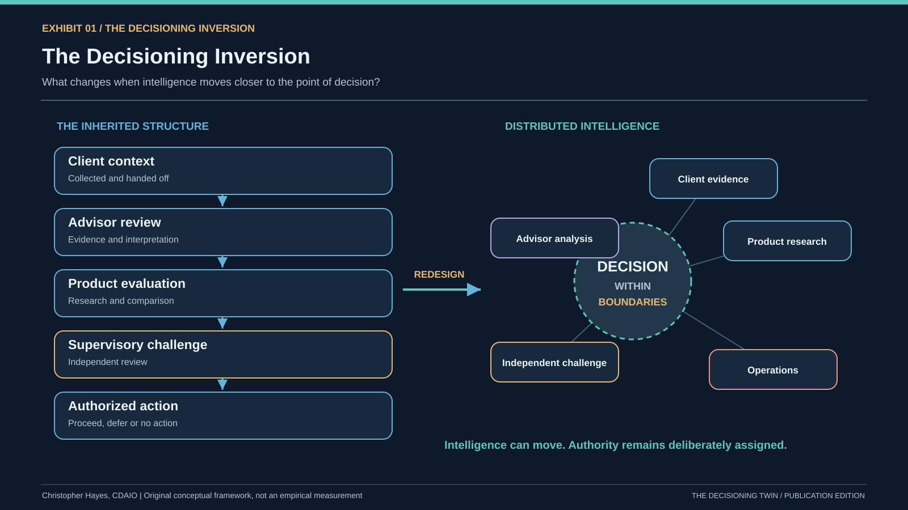
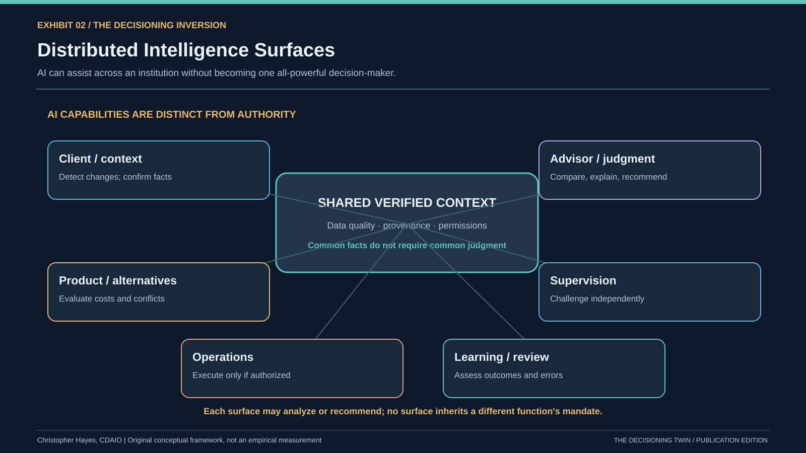
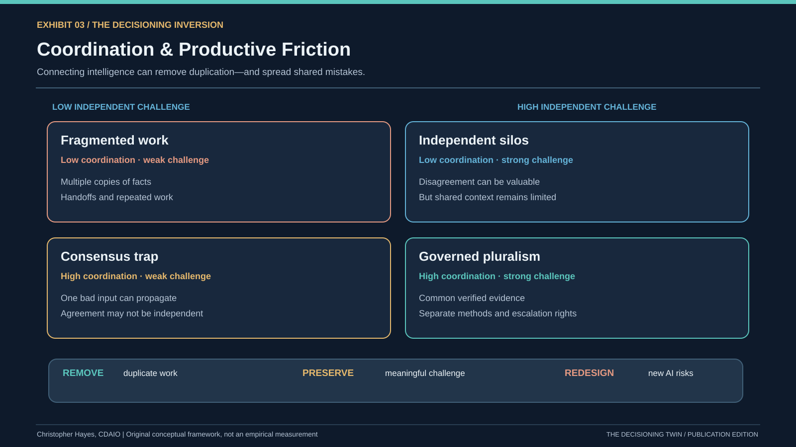
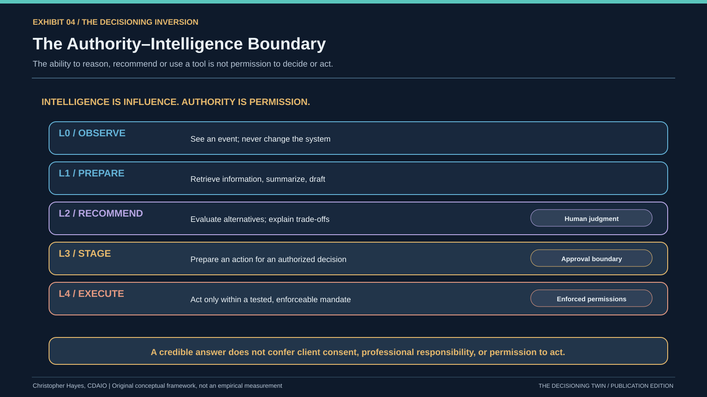
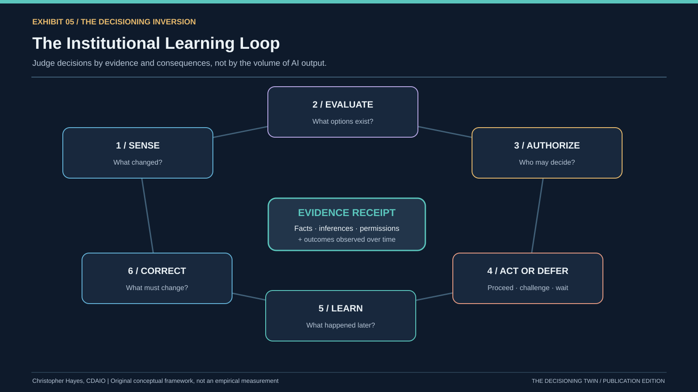

# The Decisioning Inversion

> Publication reading edition, prepared from the 15-page Word/PDF research paper. Original formatting and figures are available in the separately distributed publication package. Synthetic examples are not empirical measurements.

acting?

*Christopher Hayes, CDAIO, MPS DAV, MBAN, MSc AI (Boston University) Candidate*

*Research and publication edition | 7 November 2026 | Wealth management dealer case*

study; implications across sectors

## Executive summary — what is being tested

AI is not merely another organizational actor. It may be embedded at multiple decision surfaces: where client facts are gathered, alternatives framed, recommendations challenged, permissions evaluated, and consequences monitored. A wealth management dealer is a productive case study because these functions are interdependent without sharing identical duties. The governing problem is not how to connect every source of intelligence. It is how to coordinate evidence while preserving legitimate authority, independent challenge and client protection.

This paper advances five original conceptual exhibits, explains where the dealer lens illuminates a broader organizational question, and distinguishes peer-reviewed research, regulatory material, original hypotheses and illustrative simulation. The associated Decisioning Twin V3.2 is a synthetic teaching model, not empirical proof of cost savings, supervisory effectiveness, or regulatory compliance.

## The central argument

Most organizations have approached artificial intelligence as another way to improve the productivity of people and the speed of existing processes. But that framing risks missing the more consequential transformation.

We built much of the modern organizational world around human intelligence: its strengths, limitations, scarcity, and costs of coordination. Hierarchies move information to people with authority. Departments concentrate expertise. Reports compress fragmented evidence. Committees reconcile conflicting perspectives and distribute responsibility. Policies, supervision, and audit trails constrain conduct and preserve accountability.

These arrangements are not merely inefficient remnants of another era. Some compensate for limited attention and imperfect information. Others exist to protect rights, manage conflicts, reconcile competing interests, and make authority legitimate. We must not confuse the two.

AI can materially change the first set of constraints, while making parts of the second set more consequential. The question is not how to automate the machinery we inherited. It is which parts

of that machinery should be removed, which should be redesigned, and which must be preserved or strengthened.

For a wealth management dealer, that is not an abstract design question. The advice and service experience is a chain of interdependent decisions involving the client, the registered advisor, the dealer, product oversight, supervisory functions, operations, and sometimes external portfolio managers or carrying brokers. An AI tool can assist many of these actors. It does not thereby inherit their authority or responsibilities.

The central proposition of this essay is the Decisioning Inversion: intelligence can increasingly move toward the point of need, while authority and accountability must be deliberately designed around its influence and action.

## 1. Why the institutional architecture looks the way it does

Three traditions make the argument sharper. Herbert Simon's bounded rationality explains why people cannot analyze unlimited alternatives or possess complete information. Jay Galbraith describes organizational structures as responses to information-processing requirements and uncertainty. Ronald Coase explains organizational boundaries, in part, through the relative costs of coordination and transactions. [1–3]

These are not identical theories, but together they expose three different scarcities. First, cognitive scarcity: finite attention, expertise, and ability to process evidence. Second, coordination scarcity: the time and costs of combining people, systems, and work. Third, institutional scarcity: limited legitimacy, trust, authority, and ability to reconcile interests without losing accountability.

AI can reduce the cost of selected cognitive activities. Integrated tools and agents may reduce certain coordination costs. But AI cannot generate legitimate decision rights merely by producing a credible explanation, nor make competing economic interests disappear through greater accuracy.

Exhibit 1 — The Decisioning Inversion shows the difference between moving information through a hierarchy and locating intelligence near the decision inside a governed authority structure. A crucial qualification: hierarchies serve political, professional, and risk-management functions as well as informational ones. AI does not automatically flatten them.

Exhibit 1. The Decisioning Inversion. Original conceptual framework by Christopher Hayes. Explore [the corresponding interactive act](../locked_v3_2/index.html#act-1).

The strongest expression of the thesis is therefore a constraint migration, not a claim of unlimited machine intelligence. As analysis becomes cheaper, verification, authorization, data integrity, exception handling, and institutional accountability can become binding constraints.

## 2. A decision is not a point in time; it is a system

Most discussions of AI adoption frame decisions as isolated outputs: the recommendation, the approval, or the trade. In practice, a consequential decision has a lifecycle: sense a condition; frame the problem; develop alternatives; evaluate evidence; authorize an action; execute within a mandate; observe the result; and learn.

AI can influence the very first stages before anyone notices that an intervention occurred. A model may decide which client situations to flag, which information to retrieve, which products to compare, which time horizon to emphasize, and how alternatives are ordered. An advisor may retain final approval yet still operate inside an agenda largely shaped by a system. This is the difference between formal decision rights and informational influence.

The question of control should therefore extend beyond 'who pressed approve?' to 'who defined the problem, what evidence was excluded, what conflicts affected the ranking, what policy constrained the action, and can we reconstruct the decision as it actually occurred?'

This is one reason transparency about model limitations and decision provenance matters. Independent challenge must be able to contest the framing and supporting evidence, not just the final answer.

## 3. A wealth management dealer contains several decision systems at once

A dealer is best understood as a network of interlocking decision rights, not an advisory workflow with a compliance gate attached at the end.

The client provides objectives, circumstances, instructions and authorizations, and should have meaningful opportunities to understand and contest consequential decisions. The registered advisor interprets the context, gives advice and exercises professional judgment within their registration and the dealer's business model. The dealer and product governance functions establish product due diligence, approved offerings, conflict management and policies. Supervision and compliance independently monitor, investigate and remediate issues. Operations processes authorized instructions and controls settlement, records and servicing. AI and Data platforms can observe, prepare, compare and orchestrate within permitted access and execution boundaries.

The same activity can require distinct decisions from several actors. Consider a concentration warning. AI may detect a potential issue using holdings and a security master. The advisor considers the client context and whether a recommendation is appropriate. The client may need to decide whether to act in a non-discretionary relationship. The dealer's supervision framework assesses the resulting conduct, and operations acts only on valid instructions. These are complementary decisions, not redundant approvals.

Exhibit 2 — Distributed Intelligence Surfaces separates AI support, advisor/client judgment, dealer controls and the evidence required for reconstruction. The framework is an illustrative design, not a regulatory RACI. Roles must be tailored to each dealer, registration category, account arrangement and applicable rules.

Exhibit 2. Distributed Intelligence Surfaces. Original conceptual framework by Christopher Hayes. Explore [the corresponding interactive act](../locked_v3_2/index.html#act-2).

Canadian requirements make this separation especially important. CIRO's Client Focused Reforms address material conflicts, KYC, product due diligence, KYP, and suitability. Suitability requires consideration of a client's KYC, product knowledge, account-level implications such as concentration and liquidity, costs, and a reasonable range of alternatives available through the firm, with the client's interest first. Joint CSA–CIRO Staff Notice 31-368 found continuing deficiencies in policies, KYC/KYP and suitability practices, including documentation. [4–6]

The guidance also emphasizes meaningful client interaction in KYC; an AI-prepared questionnaire cannot simply manufacture client confirmation. Tools must not manipulate KYC to justify an investment or treat a product's risk label as a complete suitability assessment. [5]

Importantly, not every dealer relationship is the same. Order-execution-only models have different suitability obligations from full-service advisory accounts; discretionary or managed accounts involve specifically governed authority; arrangements between a dealer and external portfolio manager can allocate different client responsibilities. [7–8]

## 4. Where human and AI decisioning coexist productively

Meeting preparation and client context. AI can assemble approved holdings, service issues, relevant account events and prior documented interactions; the advisor evaluates meaning, asks the client to confirm material changes, and decides what is worth discussing. The friction to address is poor system integration and duplicated preparation. The control to preserve is a meaningful relationship and accurate KYC.

Suitability analysis and alternative comparison. AI can compare concentration, liquidity, costs, tax-sensitive considerations where appropriate, and available alternatives. The registered professional assesses whether the resulting recommendation puts the client first. Dealer product controls and independent supervision address conflicts and conduct. The friction is not that a human remains responsible; it is that human review can become a rubber stamp if evidence is weak or choices have already been biased.

Trade surveillance and supervision. AI can strengthen exception selection by connecting transactions, holdings, client context and behaviour across time. CIRO guidance permits risk- based selection for certain post-trade reviews and recognizes technology for review selection, while emphasizing dealer supervision and escalation. [9] A control function should be able to challenge the model, assess false negatives and take remedial action. Advisor productivity and supervisory independence are separate design goals.

Product oversight and advisor assistance. AI can compare fund features, costs and concentration implications against an approved universe. Where an affiliated or proprietary product is involved, the system must not quietly substitute commercial objectives for a client-first assessment. A model optimized for distribution or revenue is not a neutral suitability engine merely because its answers are technically accurate.

Client servicing and operations. AI may help draft communications, prepare service requests, detect inconsistencies and route exceptions. It should not infer that the ability to draft or stage an instruction is permission to submit it. Privacy, identity, fraud prevention, record retention and permitted execution mandates remain separate requirements.

## 5. Where decisioning collides

The deepest friction arises when an AI system collapses distinct institutional purposes into one optimization target.

A dealer may seek lower servicing cost, greater advisor capacity, higher product adoption and better client outcomes. These are not always aligned. A model that maximizes the likelihood of a transaction, the retention of assets, or the sale of an affiliated product can conflict with the independent evaluation needed to put a particular client's interests first. The answer is not to pretend commercial objectives do not exist; it is to make the conflicts visible and create constraints, challenge, and evidence of how they were resolved.

Other collisions arise from data ownership (two systems disagree about the client's time horizon), authority (an agent is capable of staging or submitting a trade without a valid mandate), temporal mismatch (latest market data compared with stale KYC), explainability (an advisor receives a rank without the basis of the comparison), operating model (client, advisor and supervisory functions believe another actor performed the check), and correlated risk (the same flawed model generates and independently 'checks' a recommendation).

Canadian privacy guidance adds an often underestimated point. AI inferences about an identifiable client may themselves be personal information; lawful authority, meaningful consent where applicable, appropriate purposes, minimization, safeguards, and retention require attention. A statement made in a meeting does not automatically authorize unlimited use of that information for client scoring or third-party model services. [10]

The CSA's December 2024 Staff Notice 11-348 states that existing securities laws continue to apply to AI use and highlights responsibility for technology outputs and AI-related conflicts. The CIRO 2026 compliance report explicitly addresses dealer operational controls over AI and consideration of whether material changes to business or regulatory functions require notice or registration updates. [11–12]

## 6. Productive friction, destructive friction, and authority collisions

The objective should not be to minimize every handoff. It should be to distinguish three very different kinds of friction.

Wasteful friction includes duplicate data entry, fractured systems, unnecessary searching, unclear document versions and approval chains with no identifiable decision right. AI and data engineering can reduce it through governed integration and automation.

Protective friction includes meaningful KYC confirmation, independent suitability challenge, a properly authorized client instruction, second-line oversight, complaint escalation and the right to reverse or remediate an error. This friction should become more substantive and better evidenced—not disappear because a model appears accurate.

Authority collision occurs when one system tries to exercise another actor's decision right: an AI agent adjusts KYC to make an investment appear suitable, product recommendations optimize commercial incentives without conflict controls, or an execution agent acts beyond the authority granted by the client and dealer. These require redesign, not simply faster processing.

Exhibit 3 — Coordination & Productive Friction places these categories in separate lanes: remove, preserve and redesign. That distinction also provides a more rigorous way to assess a proposed AI use case. Efficiency gains are credible only if safeguards remain effective and collision risks are controlled.

Exhibit 3. Coordination & Productive Friction. Original conceptual framework by Christopher Hayes. Explore [the corresponding interactive act](../locked_v3_2/index.html#act-3).

## 7. The authority envelope: what an AI system can do is not what it may do

The absence of a clean authority model is where AI pilots can become unsafe operational capabilities. A useful design divides participation into five levels: L0 observe; L1 prepare; L2 recommend; L3 stage action for human approval; L4 execute within expressly authorized, tested boundaries.

These levels are not permissions granted by model performance. Advancement requires tests of legal and contractual mandate, client impact and reversibility, data quality, conflicts, operational robustness, and whether the required human authorizations are actually present.

For example, using AI to draft an advisor email is meaningfully different from sending it to a client; proposing a rebalance is different from submitting an order; flagging a KYC inconsistency is different from changing the client record. A capability may safely operate at L2 in one use case and require strict exclusion from L4 in another.

Exhibit 4 — The Authority–Intelligence Boundary illustrates those levels and mandatory gates. The central idea is human-in-command: authorized humans define objectives, boundaries, interventions and recourse. That is not synonymous with placing a human approval checkbox after every model output. Nor does it negate approvals required by law or professional obligations.

Exhibit 4. The Authority–Intelligence Boundary. Original conceptual framework by Christopher Hayes. Explore [the corresponding interactive act](../locked_v3_2/index.html#act-4).

NIST's AI Risk Management Framework provides a useful governance structure, and the need for careful allocation of work is reinforced by experimental evidence. A 2024 meta-analysis of 106 human–AI experiments found that mixed teams beat humans alone on average but performed worse than the best of human or AI acting alone. Decision tasks were particularly challenging, which supports designing specific divisions of labour rather than assuming augmentation automatically delivers synergy. [13–14]

## 8. The data architecture problem hiding inside the decision problem

A dealer cannot build reliable decision intelligence on disconnected definitions of the client, account, security, holdings and transactions.

Client context lives across relationship systems, custodial records, portfolio accounting, compliance platforms, meeting notes and product repositories. A recommendation about

concentration depends on positions, an authoritative security master, transaction history, currency exposures, current values, account linkages and the basis for assessing suitability. Each data domain must carry provenance, ownership, freshness, quality and permitted use—not just field names.

The real architecture is therefore more than a warehouse or a model endpoint. It connects governed domain data, a shared semantic interpretation, model and rules services, identity and delegated permissions, workflow orchestration, and decision receipts. If one component is missing, the AI may offer convincing answers without reliable underlying authority.

This is particularly important where a dealer offers both third-party and affiliated investment products. Product attributes, costs, compensation and conflicts should be explicit data that can inform review, not hidden features influencing a ranking.

## 9. Institutional learning instead of adoption vanity metrics

Most AI programs begin by measuring licensed users, prompts, time saved and content generated. These can be useful operational indicators, but they do not establish that clients or the dealer are better served.

A dealer decision system should instead measure whether client information is more accurate and timely; whether recommendations consider appropriate alternatives and costs; whether material suitability issues are identified earlier; whether supervision finds preventable errors more effectively; whether clients understand the basis of decisions; whether false positives and false negatives remain acceptable; and whether remediation occurs quickly when something fails.

An evidence receipt creates the connection between action and learning: trigger, governing policy, record versions, model version, alternatives considered, warnings, human authorizations, execution result, supervisory resolution, and subsequent outcomes. These receipts should be appropriately scoped, access-controlled and retained under applicable requirements.

Exhibit 5 — The Institutional Learning Loop puts trusted context, intelligence, authority, outcomes and corrective feedback into a single system. It replaces the simplistic goal of 'use more AI' with the harder goal of 'make better consequential decisions and demonstrate how we know.'

Exhibit 5. The Institutional Learning Loop. Original conceptual framework by Christopher Hayes. Explore [the corresponding interactive act](../locked_v3_2/index.html#act-5).

## 10. What this means for a Data & AI leader at a dealer

This is no longer primarily a model deployment mandate. Data & AI becomes connective tissue among advisors, business owners, product governance, compliance, supervision, technology, operations and leadership. It helps translate opportunities into end-to-end work systems while preserving business accountability and independent control authority.

The operating model should begin with a decision inventory: What actual decisions are being made? By whom? Under what mandate? With what evidence? How often? What harms could follow? Which steps are waiting for intelligence, and which exist to protect clients? Where can AI prepare or recommend, and where must it not act?

Use cases should then move through constrained sandbox, proof of concept, supervised pilot and scale only when evidence supports progression. The necessary infrastructure includes canonical client, account, transaction, holdings, product and security master domains; access controls and least privilege; approved AI tools; auditable prompts and execution traces as appropriate; clear data residency and third-party use conditions; human challenge and intervention; outcome-based monitoring; and an accountable control framework.

That does not put Data & AI in charge of business advice or regulatory approvals. It gives the function responsibility for the coherence of the decision architecture, its evidence, and the connections between participants. The dealer, its authorized persons and relevant control functions retain their assigned duties.

## 11. Research agenda: how to test the thesis

The theory should be tested in deliberately matched use cases. Compare existing human workflows, AI inserted without redesign, and a redesigned human–AI decision system. Measure time from signal to responsible action, the quality of evidence, error and escalation rates, meaningful client outcomes, supervisor workload, and the cost of control. Examine not just individual accuracy but correlated errors and whether AI changes which alternatives are visible.

Conduct one experiment on meeting preparation and KYC confirmation, one on portfolio concentration and suitability support, and one on independent supervisory exception triage. Do not begin with autonomous client trades: start where accountability is clearer and feedback is measurable.

The testable claim is not that AI will eliminate the dealer's decision machinery. It is that dealers that redesign the boundaries between intelligence, authority and accountability can outperform those that merely accelerate inherited processes, provided they preserve client protections and learn from real outcomes.

## 10A. Beyond one AI assistant: intelligence distributed at different decision surfaces

The conventional AI roadmap asks where an assistant might improve a role's productivity. That is useful but too narrow. An institution can have AI-assisted client-context detection, advisor research, product comparison, supervisory pattern analysis, operating workflows and management analytics at the same time. Each surface may rely on a different model, vendor, dataset, prompt design or policy. Their information can overlap while their authority cannot be assumed to overlap.

This makes the difference between common facts and common judgment essential. Sharing one authoritative account balance can reduce inconsistencies. Having every AI reviewer depend on the same unverified client inference can make supervisory agreement less meaningful. Research on more than 350 language models found substantial correlation in errors across evaluated tasks, including when models came from different providers or architectures. That study did not test Canadian dealers; it is evidence against casually assuming a second model is an independent check. [18]

Four connections should be distinguished: (i) information sharing, where one function receives trusted data; (ii) recommendation sharing, where a claim is passed for review; (iii) delegated tasking, where one component asks another to act; and (iv) authorization, which remains subject to an independently enforced mandate. The first three are design possibilities. The fourth is an institutional control decision, not a model confidence threshold.

This distinction also reaches beyond the firm. A client's own AI agent may prepare a request, a dealer-owned AI may analyze it, and an external technology provider may assist processing. These participants do not automatically share an identity system, authorization contract, or duty

of care. Cross-organizational delegation therefore deserves a separate trust boundary, even if the user experience feels seamless.

## 10B. The coordination–independence trade-off

Institutional value can increase when decision surfaces share current, reconciled evidence. Yet dense coupling can introduce common-mode failure. If a KYC attribute is stale, product comparison, recommendation ranking and surveillance explanations may all inherit the same bad premise. A future system could be faster, more consistent—and consistently wrong.

The proposed Intelligence Coupling Matrix combines two variables: degree of coordination and strength of independent challenge. Low coordination and low independence leave fragmented work; high independence but low coordination creates siloed control; high coordination with weak challenge creates a consensus trap; and selective shared context plus independent judgment creates governed pluralism. These are conceptual configurations rather than observed performance tiers.

A practical design implication follows: verified evidence may be shared, while alternative models, separate data checks, dissent records and escalation pathways should remain available. In some situations the economically efficient answer is not to ask another AI to agree, but to stop and obtain better client facts.

## 10C. The authority–intelligence gap in agentic systems

As capabilities to retrieve, draft, rank, stage and execute become more closely connected, organizations face an authority–intelligence gap: a system may know how to take an action that it is not authorized to take. This matters for customer communications, client data changes and trading even before any genuinely autonomous financial advice emerges.

NIST's October 2026 design tenets for agent identity management distinguish an agent's reasoning from the policy enforcement layer, advocate deterministic access decisions, and propose auditable, independently maintained evidence for agent actions. These tenets are emerging voluntary design guidance, not binding Canadian dealer regulation. [20] The architectural lesson is clear: prompts that say 'do not trade' are not substitutes for enforceable service permissions, transaction-level restrictions and suitable approval flows.

The application should respect professional registration, client mandate, account structure, dealer supervision and exceptions. The conclusion 'human-in-command' should not be used as a shortcut to remove an approval actually required by law or policy. It means that consequential objectives, delegation boundaries, independent supervision, intervention rights and recourse are designed rather than implied.

## 10D. Decision outcomes, not intervention volume

An AI-enabled firm may detect more signals, produce more recommendations and shorten preparation time, yet still create unnecessary trading, notification fatigue or other unwanted

interventions. The appropriate institutional response to an alert may be to proceed, challenge, defer, or conclude that no action is warranted. The last should be an explicitly supported outcome, not a failure to convert a recommendation.

The December 2025 CSA–CIRO staff notice expressly discusses reassessments to continue holding securities, consideration of alternatives and costs, and client-specific circumstances. That makes the non-decision a useful research focus: monitoring may improve without transaction volume increasing. [6]

Evaluate ex-ante quality (what a reasonable actor could justify based on verified evidence at the time) separately from ex-post outcomes (what followed, including market effects outside the decision-maker's control). An audit trail is not itself proof that a decision was good. Its purpose is to make the supporting assumptions and accountabilities inspectable so they can be challenged and improved.

## 10E. External adoption context and limits

The Bank of England and FCA's October 2026 UK financial-services survey reported AI usage among 86% of respondents and agent deployment among 80%; only 2% reported broadly autonomous agents. These are self-reported UK financial-services findings from survey respondents, not Canadian wealth management dealer adoption rates, and do not imply that the majority of deployed agents are autonomous. They suggest a useful distinction between widespread adoption and narrowly bounded consequential authority. [19]

Similarly, a 2025 field study of 5,172 customer-support agents found an average 15% productivity effect from AI assistance; it does not establish a corresponding gain in dealer advice quality or compliance. [15] A separate 2024 meta-analysis across 106 human–AI experiments found that combined performance did not reliably exceed the better standalone performer. [14] Together these findings justify testing the entire human–AI decision configuration, rather than using adoption, speed or model accuracy as the principal success measure.

## 10F. Empirical design and falsification criteria

An initial assessment could compare three groups for a matched task: existing practice, AI assistance inserted without workflow changes, and a redesigned system with shared verified context and explicit authority controls. Predefine outcomes before deployment: evidence completeness, error detection, suitability-review quality, unresolved exceptions, time to appropriate action, downstream reviewer burden, and client comprehension. Measure false negatives as well as false positives. Protect privacy by minimizing actual client data in trials and securing appropriate permissions.

The thesis would be weakened if integrated AI consistently increased rework, expanded supervisory workload without improving risk detection, introduced correlated errors that controls failed to identify, or produced only higher recommendation volume with no meaningful

client or operational improvement. These are falsification opportunities, not inconvenient exceptions.

The five exhibits provide a design vocabulary, not a causal proof. Research-quality validation would require governance review, matched baselines, careful sampling, controls for selection effects and clear reporting of limitations.

## Conclusion: the real organizational inversion

We did not build institutions only to process information. We built them to distribute power, manage conflicting interests, make commitments credible and determine who is answerable when consequences unfold.

AI can improve the accessibility, speed and sophistication of intelligence. That is only part of the story. As it influences what deserves attention, how options are framed, which recommendations appear reasonable and which actions are initiated, it changes the infrastructure of institutional decision-making itself.

For a wealth management dealer, the destination is neither 'AI makes the decisions' nor 'the advisor approves everything AI produces.' It is an intentionally designed system where the client, registered professional, dealer and control functions retain legitimate roles, AI operates within a defined mandate, and every consequential decision can be examined and improved.

The real question is not how fast we can make existing decisions. It is which decision- making mechanisms we would design if we were starting again—while preserving everything an institution owes to the people whose lives and assets those decisions affect.

## References and primary sources

[1] Simon, H. A. A Behavioral Model of Rational Choice (1955). https://doi.org/10.2307/1884852

[2] Galbraith, J. R. Organization Design: An Information Processing View (1974). https://doi.org/10.1287/inte.4.3.28

[3] Coase, R. H. The Nature of the Firm (1937). https://doi.org/10.1111/j.1468-0335.1937.tb00002.x

[4] CIRO. Client Focused Reforms (CFRs). https://www.ciro.ca/firms/current-members/dealer-compliance/client-focused-reforms-cfrs

[5] CIRO. Know-your-client and suitability determination for retail clients. https://www.ciro.ca/newsroom/publications/know-your-client-and-suitability-determination-retail-clients

[6] CSA and CIRO. Staff Notice 31-368: Client Focused Reforms — Review of Registrants' Practices and Additional Guidance (2025). https://www.ciro.ca/newsroom/publications/joint-canadian-securities-administrators-canadian-investment-regulatory-organization-staff-notice-31-0

[7] CIRO. Guidance Respecting Order Execution Only Accounts as a Form of Third-Party Electronic Access to Marketplaces (2026). https://www.ciro.ca/newsroom/publications/guidance-respecting-order-execution-only-accounts-form-third-party-electronic-access-marketplaces-0

[8] CIRO. Service arrangements between Dealer Members and Portfolio Managers. https://www.ciro.ca/newsroom/publications/service-arrangements-between-dealer-members-and-portfolio-managers-0

[9] CIRO. Account Supervision Guidance. https://www.ciro.ca/newsroom/publications/account-supervision-guidance

[10] Office of the Privacy Commissioner of Canada. Principles for Responsible, Trustworthy and Privacy-Protective Generative AI Technologies. https://www.priv.gc.ca/en/privacy-topics/technology/artificial-intelligence/gd_principles_ai/

[11] CSA. Staff Notice 11-348 — Use of AI Systems in Capital Markets (2024). https://www.securities-administrators.ca/news/canadian-securities-administrators-issue-guidance-and-consult-on-use-of- ai-systems-in-capital-markets/

[12] CIRO. Compliance Report for 2026: Helping Dealers with Compliance. https://www.ciro.ca/newsroom/publications/ciro-compliance-report-2026-helping-dealers-compliance

[13] NIST. AI Risk Management Framework. https://airc.nist.gov/airmf-resources/airmf/5-sec-core/

[14] Vaccaro, M., Almaatouq, A., & Malone, T. When combinations of humans and AI are useful: A systematic review and meta-analysis (2024). https://www.nature.com/articles/s41562-024-02024-1

[15] Brynjolfsson, E., Li, D., & Raymond, L. Generative AI at Work (2025). https://doi.org/10.1093/qje/qjae044

[16] Bainbridge, L. Ironies of Automation (1983). https://doi.org/10.1016/0005-1098(83)90046-8

[17] Elish, M. C. Moral Crumple Zones (2019). https://doi.org/10.17351/ESTS2019.260

[18] Kim, E. M. et al. Correlated Errors in Large Language Models (ICML/PMLR, 2025). https://proceedings.mlr.press/v267/kim25e.html

[19] Bank of England & Financial Conduct Authority. Artificial intelligence in UK financial services — 2026 (26 October 2026). https://www.bankofengland.co.uk/report/2026/artificial-intelligence-in-uk-financial-services-2026

[20] NIST. Design Tenets for Agent Identity Management Systems (27 October 2026). https://www.nist.gov/blogs/cybersecurity-insights/design-tenets-agent-identity-management-systems

Scope note: This document is a research and design synthesis. It is not legal, compliance, investment or regulatory advice. Proposed rights allocations and AI autonomy levels are illustrative; implementation requires review against current law, dealer rules, registration, account types, agreements, policies, and supervision arrangements.

## Five conceptual exhibits

### Exhibit 1: The Decisioning Inversion

[Explore the corresponding interactive chapter](../index.html#act-1).

### Exhibit 2: Distributed Intelligence Surfaces

[Explore the corresponding interactive chapter](../index.html#act-2).

### Exhibit 3: Coordination and Productive Friction

[Explore the corresponding interactive chapter](../index.html#act-3).

### Exhibit 4: Authority–Intelligence Boundary

[Explore the corresponding interactive chapter](../index.html#act-4).

### Exhibit 5: Institutional Learning Loop

[Explore the corresponding interactive chapter](../index.html#act-5).
