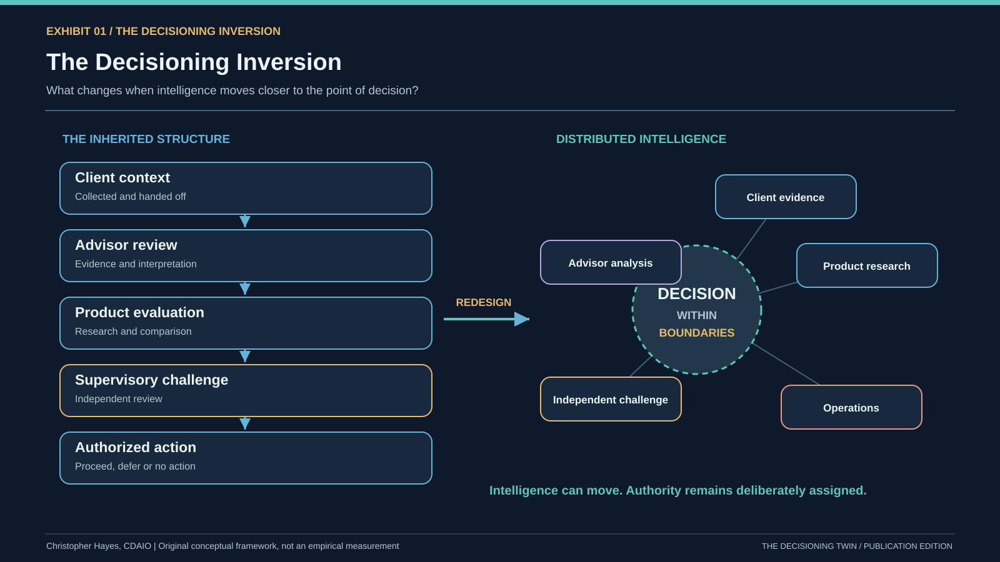
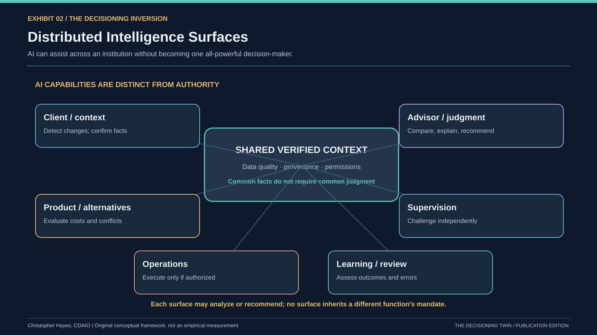
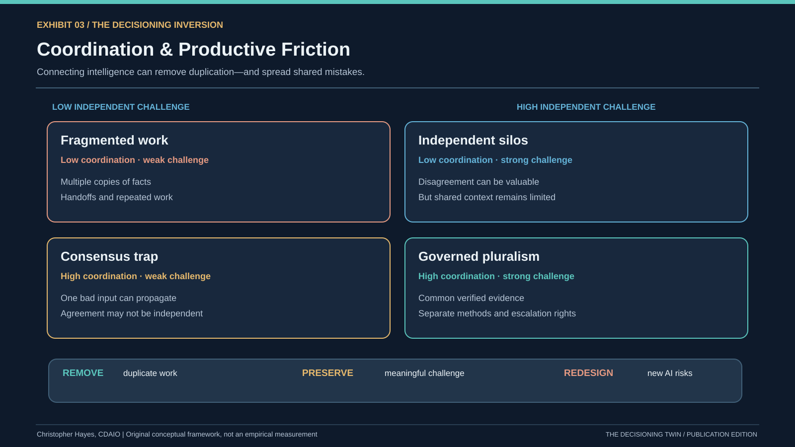
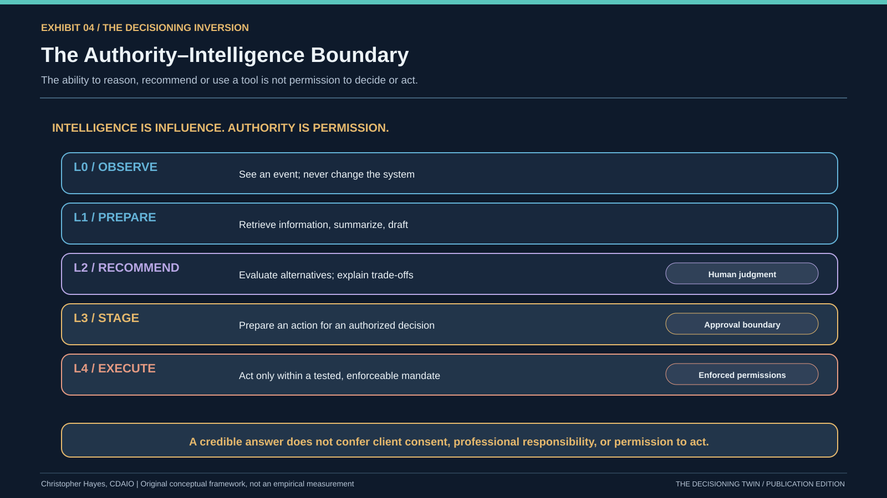
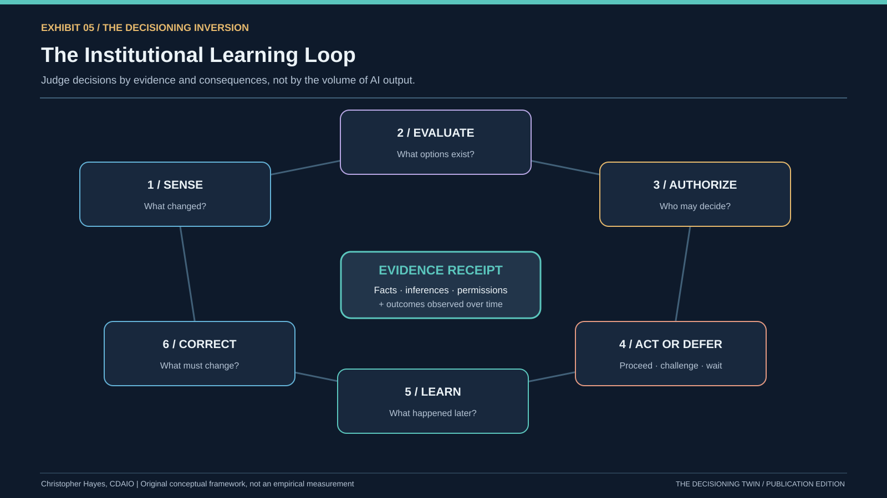

# When Intelligence Moves, Who Gets to Decide?

*The Decisioning Inversion: Why AI could change the architecture of organizations—and why the hardest question isn't how much we automate.*

**Christopher Hayes, CDAIO, MPS DAV, MBAN | MSc in AI, Boston University candidate**

I've spent a lot of my professional life around data, analytics and the systems organizations use to make decisions. Lately, one question has been bothering me more than most:

**What if we're using AI to accelerate decision-making machinery built around constraints that AI is beginning to change?**

We developed hierarchies to move information toward people with expertise and authority. We built departments around specialized knowledge. We created reports to compress complexity, meetings to coordinate judgment, and approvals to keep consequential actions within defined boundaries.

Some of that machinery compensates for limited human time, attention and access to information. Some of it protects clients, resolves competing interests, and makes authority legitimate.

Those two purposes are not the same. Yet when organizations talk about removing friction with AI, I often hear them mixed together.

That distinction is where *The Decisioning Inversion* began.

## 1. We weren't simply organizing work. We were organizing intelligence.

Herbert Simon's bounded rationality, Jay Galbraith's information-processing view of organizations and Ronald Coase's work on coordination costs offer different, complementary ways to understand why our institutions look the way they do. [Galbraith's 1974 paper](https://doi.org/10.1287/inte.4.3.28) is especially striking: organizational form is partly a response to uncertainty and what people can process.

Now intelligence can appear much closer to the decision itself. It can help spot a change, assemble evidence, generate alternatives and identify anomalies without waiting for the usual report or meeting.

But if the cost of analysis falls, other costs don't vanish. Verification, judgment, authorization and accountability may become more important.

**That's the inversion: intelligence can move, while legitimate authority doesn't automatically move with it.**

**EXHIBIT 1 — The Decisioning Inversion**

*What changes when intelligence moves from a sequence of human handoffs toward multiple decision surfaces? [Explore the inherited institution in the interactive experience](../index.html#act-1).*

## 2. AI isn't one new colleague. It can appear everywhere.

A typical AI diagram adds a glowing AI node beside the humans. I think that's the wrong picture.

Consider a wealth management dealer. AI could help an advisor prepare for a client conversation. Another system might compare investment products. Another could identify suspicious transactions. Another might reconcile account records. The client might even arrive with their own AI-generated investment analysis.

They can all influence the same decision without having the same responsibilities.

This is not uniquely a financial-services problem. A hospital, university or manufacturer could have several AI capabilities acting on overlapping facts while different people and functions retain the authority to decide.

The design challenge is not simply **where can we add AI?** It's **how do these different forms of intelligence interact—and where must their authority stop?**

**EXHIBIT 2 — Distributed Intelligence Surfaces**

*Six illustrative places intelligence can operate. Their contributions differ; their decision rights remain bounded. [Explore distributed intelligence](../index.html#act-2).*

## 3. A more connected institution can also become a more fragile one.

Imagine that an advisor AI proposes an investment, a product AI agrees, and a supervisory AI finds no issue. Three systems. Three apparent perspectives.

Now imagine all three relied on the same outdated client record.

They may not be independent at all.

This is more than a hypothetical concern about hallucinations. [Research published at ICML in 2025](https://proceedings.mlr.press/v267/kim25e.html), examining more than 350 large language models across selected tasks, found correlated model errors. It doesn't establish the failure rate of dealer systems. It does challenge the assumption that adding another model automatically gives us a second opinion.

The answer isn't to disconnect everything. Shared, verified information can be extremely useful. But sharing context and sharing judgment are different architectural choices.

I call the better objective **governed pluralism**: reliable common facts, independent ways of challenging an interpretation, and explicit escalation paths when something doesn't add up.

**EXHIBIT 3 — Coordination & Productive Friction**

*Remove the handoff that adds no value. Preserve the challenge that protects someone. Redesign the new risks created by AI. [Explore friction and shared failures](../index.html#act-3).*

## 4. Being able to act isn't the same as being allowed to act.

This is perhaps the most important distinction in the entire project.

An AI can identify a portfolio issue, compare alternatives and prepare a proposed trade. None of that automatically means it can authorize or execute the trade.

In Canadian wealth management, suitability requirements, client circumstances, investment costs, concentration, liquidity and reasonable alternatives matter. A [December 2025 CSA–CIRO review](https://www.ciro.ca/newsroom/publications/joint-canadian-securities-administrators-canadian-investment-regulatory-organization-staff-notice-31-0) identified real deficiencies in how some registrants assessed and documented these factors. The responsibilities vary with the account and registration model, but automation doesn't erase them.

The principle travels across industries: a system's ability to make a recommendation should never be confused with its permission to take a consequential action.

NIST's [October 2026 design tenets for agent identity](https://www.nist.gov/blogs/cybersecurity-insights/design-tenets-agent-identity-management-systems) make a related point: separate an agent's reasoning from the systems that enforce what it is permitted to do.

**EXHIBIT 4 — The Authority–Intelligence Boundary**

*The authority boundary isn't a disclaimer. It needs to change what the system can actually do. [Explore the authority challenge](../index.html#act-4).*

## 5. More recommendations aren't the same as better decisions.

A system that detects more signals could send more alerts, produce more recommendations and encourage more activity. But more activity isn't necessarily good for the client—or anyone else.

Sometimes the right decision is to pause. Sometimes it's to challenge an assumption. Sometimes it's to do nothing.

I keep coming back to a deceptively simple question: **Can we explain why we made the decision, based on what was actually known at the time?**

A 2024 [meta-analysis of 106 human–AI experiments](https://www.nature.com/articles/s41562-024-02024-1) found that human–AI combinations did not, on average, outperform the better of the human or AI working alone. The results varied by task and study, so this is not a verdict on today's enterprise AI systems. But it's a powerful warning against assuming that adding AI produces better decisions automatically.

A meaningful learning system needs to distinguish verified facts from inference, recommendations from approvals, and the quality of a decision *at the time* from what happened afterward.

**EXHIBIT 5 — The Institutional Learning Loop**

*The output of a decision system should not be merely an action. It should also be evidence that helps the institution learn. [Explore evidence and learning](../index.html#act-5).*

## The question I think leaders should be asking

The [Bank of England and FCA's October 2026 survey](https://www.bankofengland.co.uk/report/2026/artificial-intelligence-in-uk-financial-services-2026) found broad AI and agent adoption among responding UK financial-services firms, but very limited deployment of agents with broad autonomy. Those are UK survey responses, not Canadian dealer adoption statistics. Still, the gap between available intelligence and delegated authority is revealing.

It seems entirely possible that organizations will distribute AI into dozens of workflows before they've redesigned how those workflows make decisions together.

The risk is that we make existing machinery faster while keeping its old blind spots—and introduce some new ones.

That was my motivation for building **[The Decisioning Twin](../index.html#thesis)**, an interactive, synthetic research experience. It lets a reader follow a client event through human-centred and AI-supported institutional structures; activate intelligence at different surfaces; inspect conflicts and control boundaries; and ask why an apparently reasonable recommendation might still need to be challenged.

The wealth management dealer is the case study, not the limit of the argument. The same tensions appear wherever intelligence can influence decisions that affect other people.

**The future may not belong to the organizations that deploy the most AI. It may belong to those that redesign how intelligence, judgment, authority and accountability work together—and can show that the decisions are actually better.**

---

*Research note: The five exhibits are original conceptual frameworks. The interactive examples are synthetic, not observations of actual clients or evidence of achieved operational or investment performance. External research supports the surrounding claims but does not validate the simulation itself. Current publication draft: 7 November 2026.*

---

*GitHub reading edition: exhibit links use accessible SVG renditions and interactive chapter links point to the locked root `index.html`. For a Substack post, upload the original PNG masters and replace relative links with the confirmed GitHub Pages URL. The original manuscript remains in the downloadable publication package.*
